<div align="center">

# 🚀 MCP + LangGraph
## From Beginner to Advanced — A Visual, Hands-On AI Engineering Roadmap

**Learn the protocol. Build real servers. Orchestrate reliable agents. Ship production-minded AI systems.**


</div>

---

> [!TIP]
> **The goal is not to memorize frameworks.** The goal is to understand how an AI application discovers capabilities, chooses tools, manages state, retrieves evidence, handles failures, and protects users.

## 🖼️ Visual overview


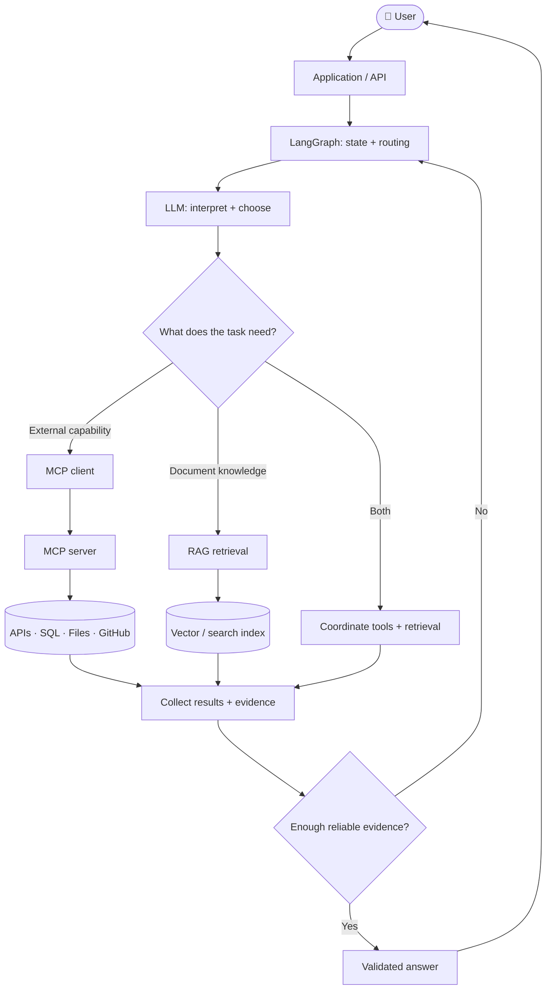

## 📚 Table of contents

- [01 — What you will build](#-01--what-you-will-build)
- [02 — The concepts](#-02--the-concepts)
- [03 — MCP architecture](#-03--mcp-architecture)
- [04 — Setup](#-04--setup)
- [05 — Build an MCP server](#-05--build-an-mcp-server)
- [06 — Inspect and test](#-06--inspect-and-test)
- [07 — Connect MCP to an LLM](#-07--connect-mcp-to-an-llm)
- [08 — Learn LangGraph](#-08--learn-langgraph)
- [09 — Full MCP + LangGraph workflow](#-09--full-mcp--langgraph-workflow)
- [10 — Add RAG](#-10--add-rag)
- [11 — Advanced workflow patterns](#-11--advanced-workflow-patterns)
- [12 — Security and production](#-12--security-and-production)
- [13 — Testing and observability](#-13--testing-and-observability)
- [14 — Portfolio projects](#-14--portfolio-projects)
- [15 — Four-week roadmap](#-15--four-week-roadmap)
- [16 — Interview preparation](#-16--interview-preparation)
- [17 — Best resources](#-17--best-resources)
- [18 — Troubleshooting](#-18--troubleshooting)
- [19 — Final checklist](#-19--final-checklist)

---

## 🎯 01 — What you will build

By following this roadmap, you will work toward a **Research & Data Assistant** that can:

- Interpret a user request.
- Discover approved tools from one or more MCP servers.
- Use an LLM to decide when a tool is relevant.
- Orchestrate work with LangGraph state, nodes, edges, and conditional routing.
- Retrieve internal documentation with RAG.
- Check evidence before answering.
- Pause for approval before sensitive actions.
- Log failures, trace tool calls, and return a useful result.

### Example request

> “Inspect my project, read its documentation, check the database schema, and create a report with evidence and recommended fixes.”

### What happens behind the scenes?

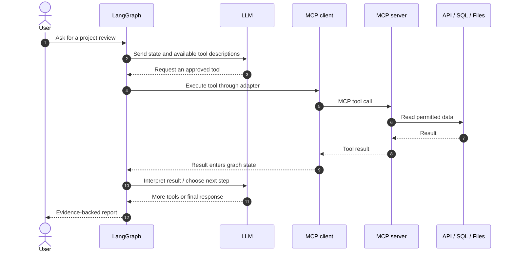

---

## 🧠 02 — The concepts

| Concept | Simple explanation | Example |
|---|---|---|
| LLM | Understands language and generates responses | Explain a database error |
| Tool/function calling | A model requests a described function | `search_repository(query)` |
| MCP | Standardized protocol for exposing and discovering capabilities | A client discovers tools on a server |
| MCP host | The AI application the user interacts with | Chat app, IDE, agent runtime |
| MCP client | Connects the host to an MCP server | Client using stdio or HTTP |
| MCP server | Exposes tools, resources, and prompts | Documentation server |
| LangGraph | Orchestrates stateful, branching workflows | Search → validate → retry |
| RAG | Retrieves relevant knowledge to ground a response | Search project docs |
| Checkpointer | Saves graph state for resuming workflows | Resume after approval |
| Human-in-the-loop | A person reviews a proposed action | Approve a database change |

### MCP vs. API vs. function calling vs. LangGraph

| Technology | Main responsibility |
|---|---|
| REST API | Defines endpoints and application operations |
| Model tool calling | Lets a model request a function using a schema |
| MCP | Standardizes capability discovery and communication |
| LangGraph | Controls workflow state, branching, loops, and resumability |
| RAG | Retrieves evidence from external knowledge sources |

**Memory trick:** MCP is the capability interface; LangGraph is the workflow controller; the model is the language/reasoning component; RAG is a knowledge-retrieval pattern.

---

## 🏗️ 03 — MCP architecture


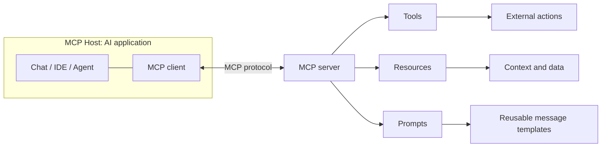

### The three server primitives

| Primitive | Typically controlled by | Use it for |
|---|---|---|
| **Tools** | Model requests, host enforces policy | Search, calculate, call an API |
| **Resources** | Application/client chooses context | Documentation, records, files |
| **Prompts** | User or application invokes template | Code review, report summary |

The host/client/server separation matters: **an MCP server does not directly talk to the model by itself**. The host orchestrates the model interaction and communicates with servers through clients.

### Transport basics

- **stdio:** commonly used when a host launches a local server process.
- **Streamable HTTP:** for remote or HTTP-hosted MCP servers.
- **SSE:** encountered in older implementations and migration scenarios; follow the current specification and SDK guidance.

Choose the transport supported by the host and deployment. Do not mix transport configuration from unrelated examples.

---

## ⚙️ 04 — Setup

### Prerequisites

- Python fundamentals: functions, type hints, exceptions, modules, virtual environments.
- Basic async/await, JSON, HTTP APIs, and Git.
- An LLM provider that supports tool calling, or a local model with compatible support.
- A terminal and VS Code (or another editor).

### Create a project

```bash
mkdir mcp-langgraph-lab
cd mcp-langgraph-lab
python -m venv .venv
```

Activate the environment:

```powershell
# Windows PowerShell
.venv\Scripts\Activate.ps1
```

```bash
# macOS / Linux
source .venv/bin/activate
```

Install the core packages:

```bash
python -m pip install --upgrade pip
pip install "mcp[cli]" langgraph langchain-mcp-adapters
```

Install the provider integration you choose and follow its official setup guide for API keys and model identifiers.

> [!IMPORTANT]
> SDK APIs evolve. The MCP Python SDK currently documents a v2 stable release line, while many older tutorials use v1 imports and patterns. Check the official docs before mixing examples. Pin tested dependencies in a lockfile for reproducibility.

Create `.gitignore`:

```gitignore
.venv/
__pycache__/
*.py[cod]
.env
.env.*
!.env.example
.pytest_cache/
.coverage
htmlcov/
```

Never commit secrets or real credentials.

---

## 🛠️ 05 — Build an MCP server

Create `server.py`:

```python
from mcp.server.fastmcp import FastMCP

mcp = FastMCP("Learning Calculator")


@mcp.tool()
def add(a: float, b: float) -> float:
    """Add two numbers."""
    return a + b


@mcp.tool()
def multiply(a: float, b: float) -> float:
    """Multiply two numbers."""
    return a * b


@mcp.tool()
def percentage(value: float, percent: float) -> float:
    """Calculate a percentage of a value."""
    return value * percent / 100


if __name__ == "__main__":
    mcp.run(transport="stdio")
```

### Understand `@mcp.tool()`

1. Registers a Python function as a tool.
2. Uses the function name and docstring as useful metadata.
3. Uses type annotations to describe arguments.
4. Lets a compatible client discover and call the tool over MCP.

It does not automatically connect the function to every LLM. You still need a host/client integration.

### Extend the server

Try these exercises:

- Add `subtract` and `divide`.
- Define how division by zero is handled.
- Add input constraints and meaningful error messages.
- Add a read-only resource for a small documentation file.
- Add a reusable prompt template for explaining a topic.
- Write down which operations are read-only and which have side effects.

Check the official SDK guide for the exact decorators and server class supported by your installed version.

---

## 🔬 06 — Inspect and test

Use the [MCP Inspector](https://github.com/modelcontextprotocol/inspector) to explore server capabilities.

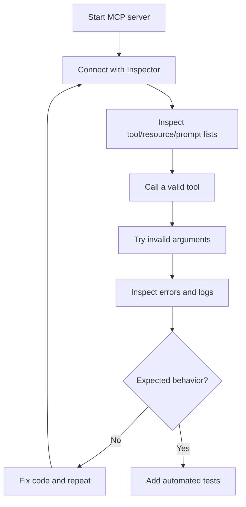

### Test matrix

| Test | Expected result |
|---|---|
| Valid input | Correct result |
| Missing/wrong-type argument | Clear validation error |
| Invalid business input | Safe failure |
| External dependency unavailable | Controlled error or bounded retry |
| Unauthorized action | Denied before execution |
| Duplicate request | Defined, safe behavior |

A successful Inspector call is only the first step. Test the actual application and graph integration too.

---

## 🤖 07 — Connect MCP to an LLM

There are two distinct responsibilities:

1. **MCP client:** discovers and calls tools on MCP servers.
2. **LLM integration:** provides tool schemas to the model and processes its tool-call response.

### Discover tools with the LangChain MCP adapter

```python
import asyncio
from langchain_mcp_adapters.client import MultiServerMCPClient


async def main():
    client = MultiServerMCPClient(
        {
            "calculator": {
                "transport": "stdio",
                "command": "python",
                "args": ["server.py"],
            }
        }
    )

    tools = await client.get_tools()

    for tool in tools:
        print(tool.name, "-", tool.description)


if __name__ == "__main__":
    asyncio.run(main())
```

Run this from the directory containing `server.py`, or configure an absolute path and the correct virtual-environment interpreter.

**This step discovers tools; it does not yet call an LLM.** Verify discovery first so you can separate protocol issues from model issues.

### Tool-calling workflow

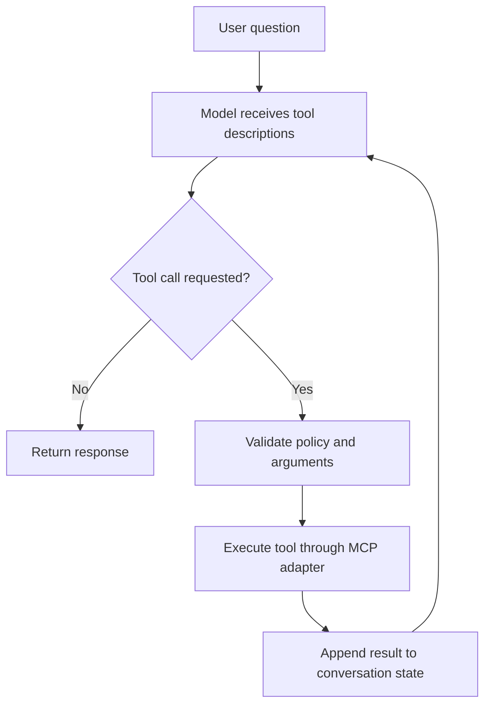

The model's choice is not authorization. Enforce permissions in application/server logic before any sensitive operation.

---

## 🕸️ 08 — Learn LangGraph

LangGraph models an application as a graph of stateful steps.

- **State:** information carried between steps.
- **Node:** function that reads state and returns updates.
- **Edge:** transition between nodes.
- **Conditional edge:** chooses a route based on state.
- **ToolNode:** runs tool calls from model messages.
- **Checkpointing:** persists state so a workflow can resume.
- **Interrupt / human approval:** pauses execution for review.

### First graph

```python
from typing import TypedDict
from langgraph.graph import StateGraph, START, END


class State(TypedDict):
    question: str
    answer: str


def answer_question(state: State) -> dict:
    # Replace this with a model call or real application logic.
    return {"answer": f"You asked: {state['question']}"}


builder = StateGraph(State)
builder.add_node("answer", answer_question)
builder.add_edge(START, "answer")
builder.add_edge("answer", END)

graph = builder.compile()

result = graph.invoke({
    "question": "What is MCP?",
    "answer": "",
})

print(result["answer"])
```

This example teaches graph mechanics; it is not an autonomous agent yet.

### When should you use a graph?

Use a graph when you need branching, loops, validation, state, resumability, or human approval. A simple function or chain is often better for a fixed, predictable sequence.

---

## 🔗 09 — Full MCP + LangGraph workflow

The following illustrates the common integration pattern. Install and configure a provider integration that supports tool calling. Verify model IDs and imports against your installed versions.

```python
import asyncio
import os

from langchain.chat_models import init_chat_model
from langchain_mcp_adapters.client import MultiServerMCPClient
from langgraph.graph import StateGraph, MessagesState, START
from langgraph.prebuilt import ToolNode, tools_condition


async def main():
    model = init_chat_model(
        os.environ.get("CHAT_MODEL", "openai:gpt-4.1")
    )

    client = MultiServerMCPClient(
        {
            "calculator": {
                "transport": "stdio",
                "command": "python",
                "args": ["server.py"],
            }
        }
    )

    tools = await client.get_tools()
    model_with_tools = model.bind_tools(tools)

    def call_model(state: MessagesState):
        response = model_with_tools.invoke(state["messages"])
        return {"messages": [response]}

    builder = StateGraph(MessagesState)
    builder.add_node("agent", call_model)
    builder.add_node("tools", ToolNode(tools))
    builder.add_edge(START, "agent")
    builder.add_conditional_edges("agent", tools_condition)
    builder.add_edge("tools", "agent")

    graph = builder.compile()

    result = await graph.ainvoke({
        "messages": [
            {"role": "user", "content": "What is 125 multiplied by 8?"}
        ]
    })

    print(result["messages"][-1].content)


if __name__ == "__main__":
    asyncio.run(main())
```

### Read the workflow

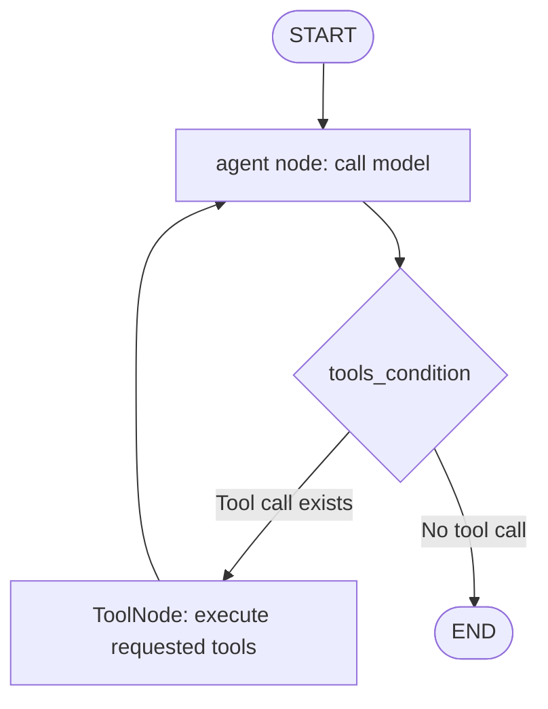

- `bind_tools(tools)` supplies tool descriptions and schemas to the model.
- `call_model` invokes the model and updates the message state.
- `ToolNode` executes requested tools.
- `tools_condition` chooses whether to execute tools or finish.
- The edge back to `agent` lets the model interpret the result and decide what happens next.

> [!WARNING]
> Add production limits for maximum tool calls, execution deadlines, allowed tools, cost, and permissions. The example is a learning scaffold, not a complete production security boundary.

---

## 📚 10 — Add RAG

MCP and RAG solve different problems:

- **MCP:** exposes capabilities and context sources through a standard protocol.
- **RAG:** retrieves relevant information to ground an answer.
- **LangGraph:** coordinates retrieval, tools, validation, and response generation.

### RAG pipeline


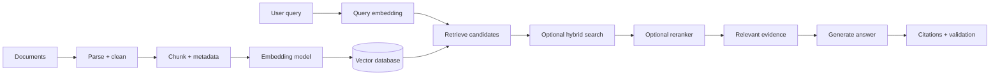

### Learning progression

1. Parse documents and preserve source metadata.
2. Compare fixed-size, recursive, semantic, and document-aware chunking.
3. Generate embeddings and store chunks.
4. Implement top-k retrieval.
5. Measure retrieval quality on a small test set.
6. Add metadata filtering when useful.
7. Compare vector search with BM25/hybrid retrieval.
8. Experiment with reciprocal rank fusion and reranking.
9. Add query rewriting or multi-step retrieval only if evaluations justify it.
10. Cite sources and handle cases where evidence is missing.

### Combined MCP + RAG + LangGraph

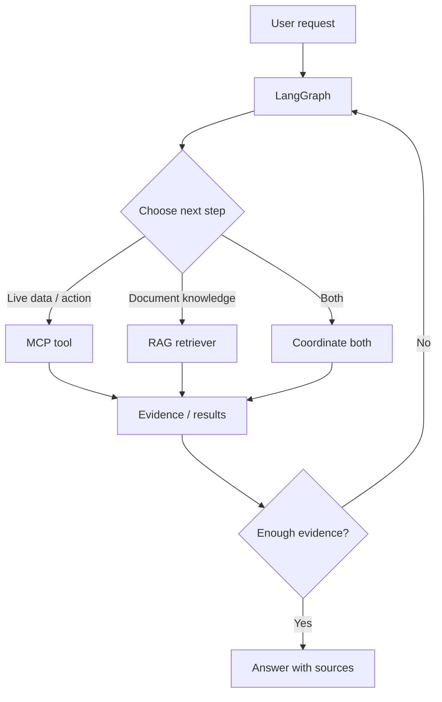

Not every request needs both tools and RAG. Route only when useful, then evaluate whether each component improves task success.

---

## 🧠 11 — Advanced workflow patterns

### Pattern A: Multiple MCP servers

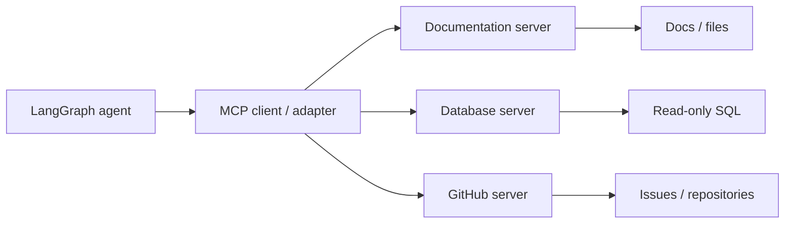

Use explicit server configuration, understandable tool names, and distinct permissions for each server.

### Pattern B: Human approval for risky operations

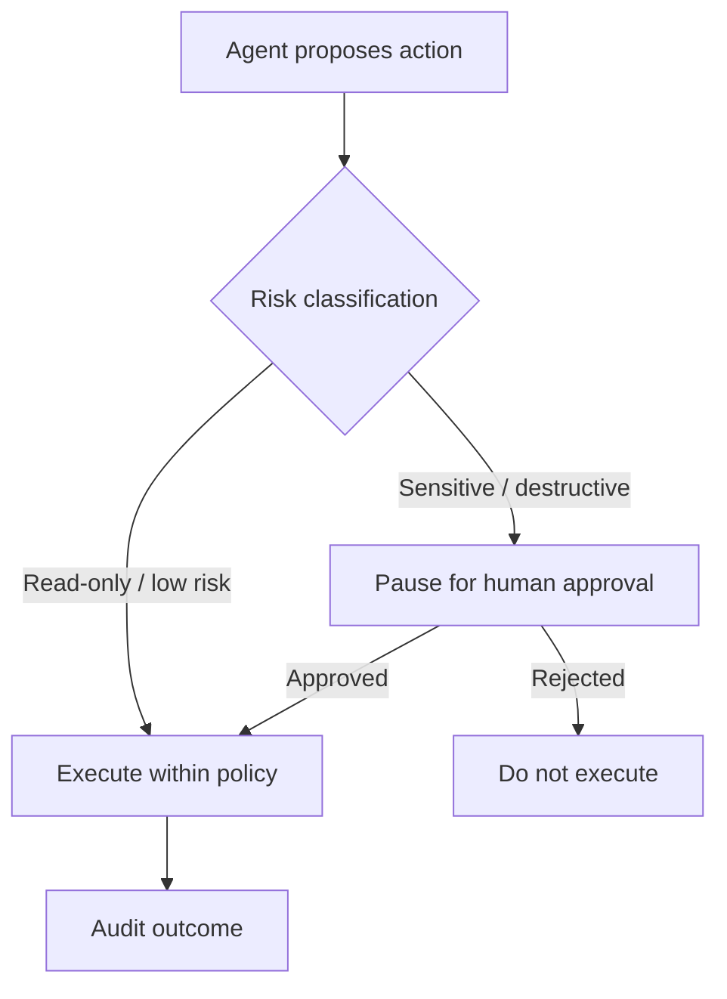

Examples requiring special care include deleting records, sending external messages, changing permissions, purchasing items, or writing to production databases. Approval must be enforced by application logic, not merely requested in a prompt.

### Pattern C: Bounded retry and validation

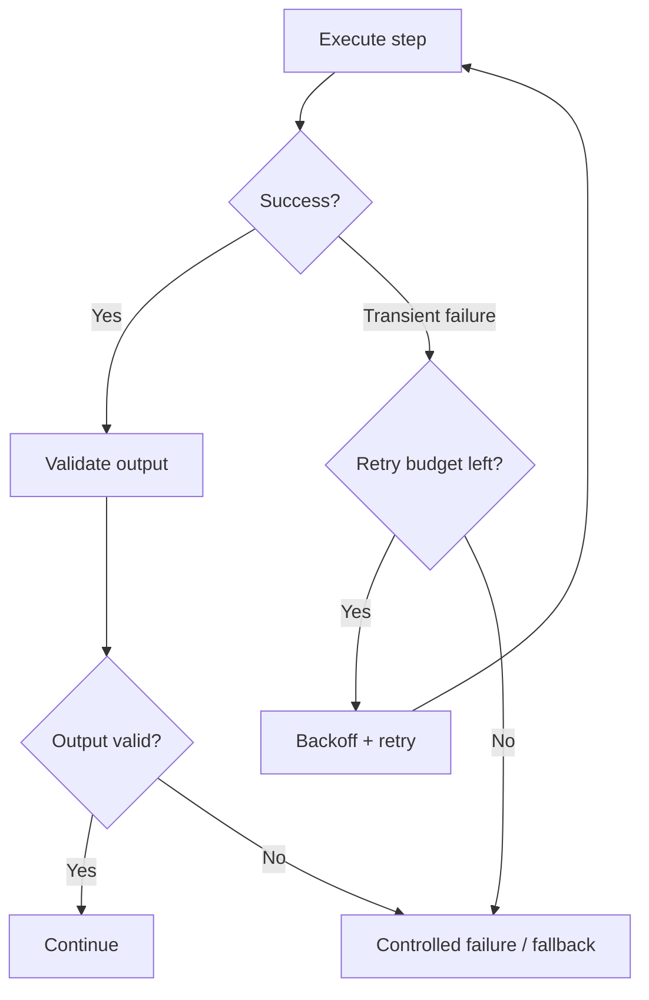

Use bounded retries, timeouts, cancellation, and idempotency controls. Never blindly retry a destructive operation.

### Pattern D: Checkpointing and resumability

Use a supported durable checkpointer when workflows must resume after interruption or wait for approval. In-memory state is useful for experiments but is not durable across process restarts. Secure checkpoint storage and isolate state by user/tenant.

### Pattern E: Multi-agent systems

Start with one agent and well-defined tools. Add subgraphs or multiple agents only when separate responsibilities or parallel work demonstrably improve results. More agents can increase latency, cost, and failure modes.

---

## 🔐 12 — Security and production

Treat every tool as a security boundary.

| Risk | Mitigation |
|---|---|
| Unauthorized operation | Server-side authentication and authorization |
| Prompt injection in retrieved text | Treat content as untrusted data; enforce policy in code |
| Secret leakage | Secret manager, redacted logs, no keys in prompts |
| Duplicate side effects | Idempotency keys and operation-status checks |
| Infinite loops | Maximum steps, deadlines, budgets, cancellation |
| Untrusted server/tool metadata | Explicit server allowlists and review |
| Cross-user data leakage | Tenant-aware queries and checkpoint/resource isolation |
| Network interception | HTTPS/TLS and validated credentials |
| Excessive API usage | Rate limits, quotas, per-user budgets |

### Production readiness workflow

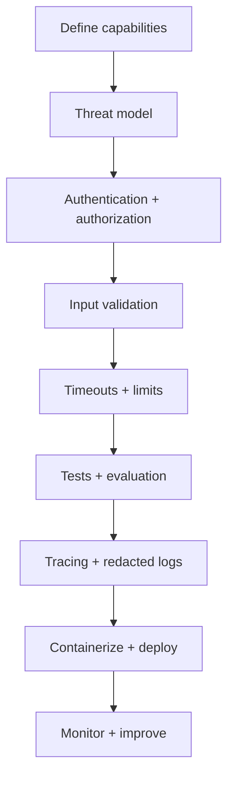

### Production checklist

- [ ] Least-privilege tools and data access.
- [ ] Authentication and per-operation authorization.
- [ ] Input validation on the server.
- [ ] Secrets kept outside source control.
- [ ] Sensitive actions require explicit approval.
- [ ] Tool-call count, timeout, and cost limits.
- [ ] Bounded retries and idempotency for side effects.
- [ ] Prompt-injection and unauthorized-access tests.
- [ ] Redacted logs and trace correlation.
- [ ] Tenant-aware state and data isolation.
- [ ] Documented failure and recovery behavior.

---

## 🧪 13 — Testing and observability

### Testing layers

1. **Unit tests:** pure functions, validation, permissions.
2. **MCP server tests:** discovery, inputs, results, failures.
3. **Graph tests:** state updates, routing, stopping conditions.
4. **Integration tests:** graph + test MCP server + controlled model.
5. **Security tests:** prompt injection, unauthorized IDs, repeated calls.
6. **Evaluation set:** representative user requests and expected outcomes.

### Useful metrics

- Task success and answer correctness.
- Tool-call success/error rate.
- Retrieval quality.
- End-to-end and per-tool latency.
- Token usage and estimated cost.
- Tool calls per request.
- Timeout, retry, and cancellation rates.
- Human approval/rejection rates.

Recommended tools:

- [LangSmith](https://docs.langchain.com/langsmith/home) — tracing and evaluation.
- [OpenTelemetry](https://opentelemetry.io/docs/) — vendor-neutral telemetry.
- [pytest](https://docs.pytest.org/) — Python testing.
- [Docker](https://docs.docker.com/) — repeatable environments.

Do not log credentials, access tokens, or unnecessary personal data.

---

## 🧰 14 — Portfolio projects

Build these in order. Each project should have a README, architecture diagram, setup instructions, tests, example inputs/outputs, limitations, and a short demo.

| Project | Core skills | Deliverable |
|---|---|---|
| 1. Calculator MCP server | Tools, schemas, Inspector | Tested MCP server |
| 2. Documentation assistant | MCP + LLM tool calling | Agent calls a real tool |
| 3. Read-only SQL analyst | Schema inspection, permissions | Safe database assistant |
| 4. RAG knowledge assistant | Chunking, embeddings, retrieval | Answers with citations |
| 5. Research agent | LangGraph routing, retries, validation | Multi-step workflow |
| 6. Production-style capstone | FastAPI, security, tracing, Docker | Reproducible end-to-end demo |

### Capstone architecture

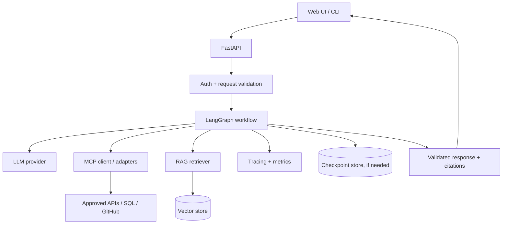

**Make the capstone stand out:** include one successful task, one controlled tool failure, one rejected unauthorized action, an evaluation set, and a short explanation of design trade-offs.

---

## 🗓️ 15 — Four-week roadmap

| Week | Learn | Build | Exit criteria |
|---|---|---|---|
| 1 | MCP architecture, tools/resources/prompts, Python async | Calculator server + Inspector | Can explain and test an MCP server |
| 2 | Model tool calling, adapter, validation, errors | Documentation assistant | Model can call an MCP tool |
| 3 | LangGraph state, nodes, edges, loops, checkpointing | Research workflow | Graph branches and stops correctly |
| 4 | RAG, evaluation, security, tracing, Docker | Capstone | Reproducible demo with tests |

### Suggested daily routine

- **30–45 min:** read official docs.
- **60–90 min:** implement and debug.
- **15 min:** write notes, tests, and a short explanation.

Spend more time building than collecting tutorials.

---

## 💬 16 — Interview preparation

### Fundamentals
1. What problem does MCP solve?
2. Explain host, client, and server.
3. What are tools, resources, and prompts?
4. MCP vs REST API vs function calling?
5. How does tool discovery work?
6. What are stdio and Streamable HTTP transports?

### LangGraph and integration
7. Explain state, nodes, edges, and conditional edges.
8. How does a tool-calling loop work?
9. What does `ToolNode` do?
10. How do you prevent infinite tool loops?
11. When do you need checkpointing?
12. How would you add human approval?
13. How do you connect multiple MCP servers?
14. How do you distinguish tool errors from transport errors?

### RAG and production
15. When is RAG useful if tools are available?
16. How do you evaluate retrieval quality?
17. How do you defend against prompt injection?
18. How do you authorize sensitive tools?
19. How do you handle retries, timeouts, and duplicate side effects?
20. What would you trace in production?
21. When is a simple chain better than an agent?
22. How would you test tenant isolation?

**Strong answer formula:** define the concept → explain the flow → give an example → name a failure mode → explain how to test or secure it.

---

## 🔗 17 — Best resources

Start with official documentation. Use tutorials to reinforce concepts, but prefer current official references when examples conflict.

### MCP

- [Official MCP documentation](https://modelcontextprotocol.io/)
- [Official MCP Python SDK — current docs](https://py.sdk.modelcontextprotocol.io/)
- [MCP Python SDK — first steps](https://py.sdk.modelcontextprotocol.io/get-started/first-steps/)
- [MCP Python SDK — getting started](https://py.sdk.modelcontextprotocol.io/get-started/)
- [MCP Inspector](https://github.com/modelcontextprotocol/inspector)
- [Official MCP servers repository](https://github.com/modelcontextprotocol/servers)
- [MCP specification repository](https://github.com/modelcontextprotocol/modelcontextprotocol)

### LangGraph and integration

- [LangGraph overview](https://docs.langchain.com/oss/python/langgraph/overview)
- [LangGraph quickstart](https://docs.langchain.com/oss/python/langgraph/quickstart)
- [LangGraph graph API](https://docs.langchain.com/oss/python/langgraph/graph-api)
- [Persistence and checkpointing](https://docs.langchain.com/oss/python/langgraph/persistence)
- [Human-in-the-loop / interrupts](https://docs.langchain.com/oss/python/langgraph/interrupts)
- [LangChain MCP integration docs](https://docs.langchain.com/oss/python/langchain/mcp)
- [LangChain MCP Adapters repository](https://github.com/langchain-ai/langchain-mcp-adapters)
- [MCP adapter API reference](https://reference.langchain.com/python/langchain-mcp-adapters)

### RAG and retrieval

- [LangChain retrieval concepts](https://docs.langchain.com/oss/python/langchain/retrieval)
- [Hugging Face NLP course](https://huggingface.co/learn/nlp-course)
- [Sentence Transformers](https://www.sbert.net/)
- [Qdrant documentation](https://qdrant.tech/documentation/)
- [pgvector](https://github.com/pgvector/pgvector)

### Production engineering

- [FastAPI](https://fastapi.tiangolo.com/)
- [Docker getting started](https://docs.docker.com/get-started/)
- [OWASP Top 10 for LLM Applications](https://genai.owasp.org/llm-top-10/)
- [OpenTelemetry](https://opentelemetry.io/docs/)
- [LangSmith](https://docs.langchain.com/langsmith/home)
- [pytest](https://docs.pytest.org/)

### Best way to study each resource

1. Read the overview.
2. Run the smallest official example.
3. Change one behavior and observe the result.
4. Write a test for your change.
5. Draw the workflow from memory.
6. Build a small independent project.
7. Recheck the docs when dependencies change.

---

## 🧯 18 — Troubleshooting

| Problem | Likely cause | First checks |
|---|---|---|
| Server will not start | Wrong interpreter or path | Activate the intended environment; check the server path |
| No tools discovered | Initialization or transport mismatch | Inspect logs and connect with MCP Inspector |
| Tool works alone but fails in graph | Adapter, schema, provider, or routing issue | Print tool names and inspect model tool calls |
| Model never calls tools | Tool-call support/configuration issue | Verify model/provider support and tool descriptions |
| Graph loops endlessly | No stopping condition or ambiguous tool results | Add iteration limits and a clear exit route |
| HTTP connection fails | Wrong URL, transport, TLS, or credentials | Verify endpoint and server/client transport settings |
| Calls are slow | External service or too many agent iterations | Measure per-tool latency and bound retries |
| State does not persist | Missing durable checkpointer or wrong thread config | Configure persistence and stable thread identifiers |
| Secrets appear in logs | Unsafe logging | Redact fields and rotate any exposed secret |

---

## ✅ 19 — Final checklist

- [ ] I can explain the MCP host/client/server relationship.
- [ ] I can build and inspect an MCP server.
- [ ] I can discover tools from a client.
- [ ] I understand model tool calling.
- [ ] I can build a LangGraph with state, nodes, edges, and routing.
- [ ] I can connect MCP tools to a LangGraph workflow.
- [ ] I can add RAG and return source citations.
- [ ] I can test graph branches, tool failures, and unauthorized access.
- [ ] I enforce permissions outside the prompt.
- [ ] I understand timeouts, retries, idempotency, and checkpointing.
- [ ] I can trace latency, failures, and model/tool usage.
- [ ] I can run the project from a clean environment using documented steps.
- [ ] I can demonstrate a successful task and a safely rejected task.

---

## ⭐ The principle to remember

**Start small → understand the protocol → connect one tool → add workflow control → retrieve evidence → secure the boundaries → test → deploy.**

A strong AI engineering project is not simply an agent that answers a question. It is a system you can explain, reproduce, evaluate, secure, and operate reliably.

<div align="center">

**Built for hands-on learning — beginner to advanced AI engineering.**

</div>
